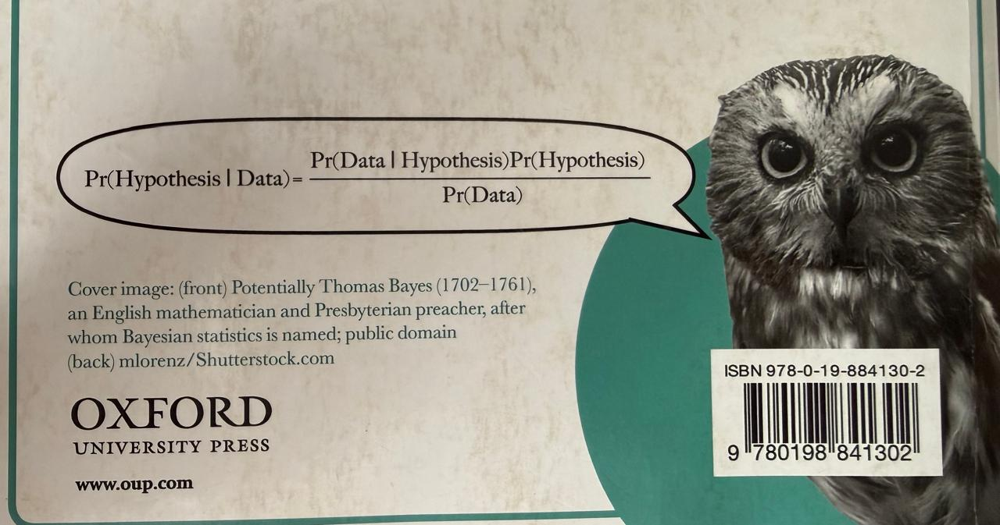
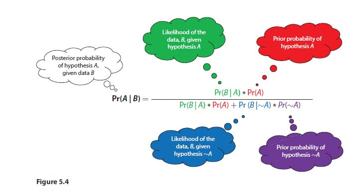

# Roteiro de Atividades: Probabilidade Condicional, Regressão Logística e Classificação

Em razão da complexidade resultante da concepção deste roteiro, como professor da disciplina CDEaDPP, 2026.2, decidi submetê-lo a apenas um dos alunos, em razão do seu notório saber no campo da Ciência de Dados.

Para que a solução a ser por ele desenvolvida sirva de **modelo arquitetônico** a ser ***replicado*** pelos demais alunos quando da confecção do Trabalho Final da disciplina: **simulação** de dados, segundo **modelos adequados**, para alimentar um adequado **Quadro de Variáveis** e Dicionário de Dados (*variable oriented studies under Large-N research*, cf. Dimiter Toshkov, 2016, chap. 7, 8 e 11) relacionados ao seu específico problema de pesquisa ora em curso junto ao PPGDP (mestrado turma X e doutorado turma II), a serem concebidos como apêndices subsequentes de seus respectivos Projetos de Pesquisa.

## Destinatário: Rafael Correa

1. **Conceito de Probabilidade Condicional**
2. **Construir Exemplos** a partir do *data set* já tratado da amostra de $n = 595$ observações, partindo do arquivo: [vscode.dev/github/cleuler/notebook/blob/main/dat/estcaso_lide_pred/casos_novos_JEC_Natal_chamado_S1392344_21.05.2025.xlsx](https://vscode.dev/github/cleuler/notebook/blob/main/dat/estcaso_lide_pred/casos_novos_JEC_Natal_chamado_S1392344_21.05.2025.xlsx)
3. **Enunciar o Teorema de Bayes**, para compreender o significado de seus termos como:

Uma ilustação ainda mais técnica e precisa vem a seguir:

4. **Conjunto de Hipóteses** como uma Partição do Espaço Amostral. Construir um exemplo com um par de hipóteses testáveis: $H_0 \times H_a$.

* **Probabilidade a Priori** dessas hipóteses atribuídas subjetivamente como um produto do conhecimento do Estado da Arte revelado pela Revisão de Escopo feita pela Hadja Rayanne: como um *Relevant Background Information*.
* **Conceito de *Likelihood* ou Verossimilhança** dessas mesmas hipóteses à luz de novos dados coletados, como, por exemplo: os desfechos (extinção, acordo ou sentença) dos $n = 595$ processos a partir de dados raspados do Datajus do CNJ.
* **Conceito de Probabilidade Total** como Fator de Normalização para todas as verossimilhanças do Conjunto de Hipóteses levantado ($H_0 \times H_a$).
* **Conceito de Probabilidade a Posteriori** como atualização das Probabilidades a Priori à luz dos novos dados coletados.
* **Calcular as Probabilidades a Priori** para o par de Hipóteses que foi concebido: $H_0 \times H_a$.
* **Construir um novo modelo logito de Regressão Multinomial** simples (cf. Giolo, 2017, cap. 8, p. 167) e outro para respostas ordinais (cf. Giolo, 2017, cap. 8, p. 188).
* **Construir um novo modelo de Regressão Logística Condicional** (cf. Giolo, 2017, cap. 9, p. 207).
* **Verificar entres esses novos Modelos qual apresenta melhor ajuste aos dados empíricos coletados e se esse novo Modelo assim escolhido é melhor** que a Regressão Logística encontrada na pesquisa com os dados primários levantados por Rayanne.
* **Comparar a Curva ROC e o índice de Gini** desses dois modelos competidores anteriores, como critério de escolha.
* **A partir dos dados novos coletados**, com os desfechos, treinar um **Classificador não supervisionado** que separe ordinalmente:

  * Lides não predatórias
  * Indício de lide predatória
  * Certeza de lide predatória
* **Verificar a Matriz de Confusão** desse **Classificador** e indicadores de sua eficiência.
* **Aplicar esse Classificador** aos dados novos obtidos junto ao Datajus do CNJ.
* **Verificar sua eficiência e gerar as respetivas listas** de:

  * Lides não predatórias
  * Indício de lide predatória
  * Certeza de lide predatória
* **Esse resultado ficou dentro do Intervalo de Confiança de Wilson de 95%** para a proporção de 17,65% [14,59%; 20,70%] encontrado na pesquisa com os dados primários de Rayanne de aproximadamente 8880 processos nos 14 JEC de Natal-RN?

A pesquisa criticamente replicada pelo Professor Cleuler relata que:

"O **indício de litigância predatória** em sentido amplo (incluindo os processos com certeza) representa **17,65%** da amostra — IC 95% de **[14,59%; 20,70%]** — o que, projetado sobre a população depurada [N_PopBase = 50.320], equivale a uma estimativa de cerca de **8.880 processos** no triênio 2022–2024.

O  **critério de certeza** , mais restritivo (três variáveis F3 positivadas simultaneamente), aponta para **5,04%** da amostra — IC 95% de **[3,29%; 6,79%]** — equivalendo a cerca de  **2.537 processos** .

> **Importante:** as projeções populacionais devem ser interpretadas como estimativas de ordem de grandeza e não como contagens absolutas precisas. A magnitude dos números é, entretanto, relevante para a administração judiciária: mesmo na hipótese mais conservadora (certeza), estima-se número superior a **dois mil quinhentos** casos no período analisado."
